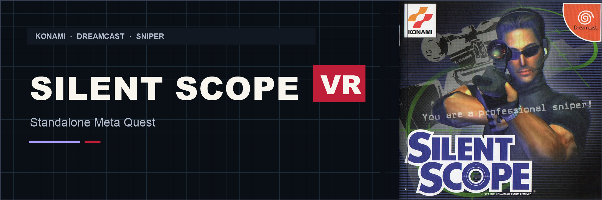

<div align="center">



# Silent Scope VR
### Konami Sniper Action · Standalone Meta Quest

[](https://github.com/vr4all-standalone/silent-scope-vr/releases/latest)
[](#installation)
[](#your-game-files)

**[⬇️ Quest APK](https://github.com/vr4all-standalone/silent-scope-vr/releases/latest/download/silent-scope-vr-quest.apk)** · **[🎮 Controls](#controls)** · **[Complete source](https://github.com/vr4all-standalone/silent-scope-vr/releases/latest/download/silent-scope-vr-source.zip)**

[Checksums](https://github.com/vr4all-standalone/silent-scope-vr/releases/latest/download/SHA256SUMS.txt) · [All releases](https://github.com/vr4all-standalone/silent-scope-vr/releases)

**[🌐 VR4ALL — Standalone VR Mod Installer](https://github.com/vr4all-standalone/vr4all-standalone)**

[☕ Donate to VR4ALL](https://ko-fi.com/vr4all)

</div>

---

## First public release

Play the Dreamcast version of **Silent Scope** in stereo VR with a tracked sniper rifle and the game's live scope view inside its eyepiece. Choose an Arcade rifle or an AWP Simulation rifle from the two labelled positions in front of you.

Version **0.0.68** includes the four-picture startup guide, pointer controls for the original game menus, and fixes for flat-view interruptions in the Woods searchlights and Hotel Imperial radio messages.

## VR features

- Immersive stereo scenery and a native wider view.
- A physical rifle model with the game's separate, live scope camera.
- Native camera zoom at **0.2×, 0.5×, 1×, 2× and 5×**, controlled with the firing-hand stick.
- Two-hand support, adjustable smoothing and scope stability, and hold-to-Focus for fine adjustments.
- Recoil and haptics tied to accepted game shots, with stronger one-hand recoil.
- **Arcade rifle** with automatic reloading.
- **AWP Simulation rifle** with an interactive bolt and magazine, cartridge loading, and casing ejection.
- Grip handoff, yellow interaction highlights, and mirrored left-handed controls.
- Purple VR4ALL settings, controller labels, and a four-picture introduction after the splash screen.

## Downloads

| Download | File |
| --- | --- |
| Meta Quest 3 / 3S | [silent-scope-vr-quest.apk](https://github.com/vr4all-standalone/silent-scope-vr/releases/latest/download/silent-scope-vr-quest.apk) |
| Complete matching source and dependencies | [silent-scope-vr-source.zip](https://github.com/vr4all-standalone/silent-scope-vr/releases/latest/download/silent-scope-vr-source.zip) |
| SHA256 checksums | [SHA256SUMS.txt](https://github.com/vr4all-standalone/silent-scope-vr/releases/latest/download/SHA256SUMS.txt) |

This release targets standalone Quest. The Windows executable used for diagnostics runs without OpenXR.

## Your game files

Supply your own **Silent Scope (USA), Dreamcast US V1.000** disc files. Setup verifies this exact four-file layout.

```text
Silent Scope (USA).cue
Silent Scope (USA) (Track 1).bin
Silent Scope (USA) (Track 2).bin
Silent Scope (USA) (Track 3).bin
```

Extract an owned archive before importing. Select the CUE and all three BIN tracks together in the app's file picker. The app keeps a working copy in its own game folder and validates it before starting VR.

The downloadable mod contains no Silent Scope disc image or BIOS. The arcade ROM set and Silent Scope 2 use different game data.

## Installation

1. Sideload **silent-scope-vr-quest.apk** onto the Quest.
2. Open **Silent Scope - VR4ALL** from the headset's app library or Unknown Sources.
3. Choose **Choose disc files** and select the four files listed above together.
4. Let setup finish validating the files, then enter VR.
5. Read the introduction, grab either labelled rifle with Grip, and use B or Y to send the game's Start command.

Install updates over the existing app to keep your game files, saves, and settings.

## Controls

| Control | Action |
| --- | --- |
| Firing-hand Grip | Pick up or release the rifle at its rear grip |
| Support-hand Grip at the fore-end | Hold the rifle with two hands |
| Release the rear grip while supporting the front | Keep holding with the support hand so the rear hand can operate the bolt |
| Release both grips | Return the rifle and show both rifle choices |
| Trigger | Fire, or point and select in the original game menus |
| B or Y | Native Start / Pause |
| Hold A | Focus Mode for smaller aiming adjustments |
| Right stick up/down | Adjust the native scope camera zoom |
| Left Menu button | VR settings |
| Left stick click | Recenter |
| Right stick click | Toggle the laser |

For left-handed play, choose Left hand in VR settings. Focus uses **X**, and scope zoom uses the **left stick**.

### Simulation rifle

The rifle starts chambered. After firing, use a free hand's **Trigger** to grab the highlighted bolt. Lift the handle, pull it back, push it fully forward, and close the handle. At an empty magazine, use Trigger to remove it and pick up a fresh magazine, then insert it into the rifle. Grip holds the rifle while Trigger interacts with the bolt and magazine.

The fresh magazine appears in front of you. Yellow mesh highlights identify the bolt or magazine that needs attention.

## Settings

The VR settings menu includes handedness, gun angle and size, laser and custom crosshair, smoothing, scope stability, haptics, world size, panel distance, HUD size, wider view, and help. Preferences persist between launches. Scope zoom starts at **1×** on a new game launch.

## Verification and known limits

**Experimental release.** The APK is installed and hash-verified on Quest 3S, and startup through the new instruction screen is verified. Earlier builds received hands-on headset feedback on aiming, two-hand support, native scope zoom, reloading, and menu selection.

Windows native replays covered the Story stages, both Night Vision routes, all three Time Attack entries, Indoor, and all nine Outdoor Shooting Range stages. The Woods and Hotel interruptions found during that audit were corrected. Brief flat frames can still appear during loading, view-setting changes, or unrecognized native geometry.

A continuous scored campaign, every end-of-round screen, and the latest build's full physical-headset playthrough remain unverified. The latest host and GPU regression suite passes **77 checks**.

## Source and credits

Download the named **silent-scope-vr-source.zip** for the full matching Flycast engine, expanded dependency sources, the Android framework and adapter, models, build instructions, and source hashes. GitHub's automatic source archive contains the project page and adapter. See [building from source](docs/BUILD.md).

This port builds on [mikermak's VR fork of Flycast](https://github.com/mikermak/hotd2-vr) and [Flycast](https://github.com/flyinghead/flycast). Upstream licenses and notices are preserved. Controller models and fonts retain their own licenses. See [credits](CREDITS.md) and [artwork provenance](docs/github/ARTWORK.md).

Silent Scope and its original artwork are owned by Konami. This is an unofficial fan project.
